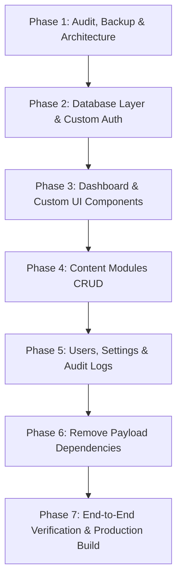

# Unchartered Custom Podcast CMS — Phase 1 Audit & Migration Plan

## Executive Summary
This document provides the complete audit, technical architecture, database schema mapping, and reversible migration plan to transition **Unchartered — Legends & Legacies** from Payload CMS to an independently owned, high-performance, custom-built Podcast CMS.

---

## 1. Complete System Audit

### 1.1 Project & Technology Stack
- **Framework:** Next.js 15.3.9 (App Router)
- **UI & React:** React 19.0.1, TypeScript 5.7.3, Tailwind CSS 3.4.17, Lucide React icons
- **Validation:** Zod 3.23.8
- **Image Optimization:** Sharp 0.33.5
- **Emails:** Resend 4.1.2 & SMTP fallback
- **Database:** SQLite (`payload.db`) via `@libsql/client` (LibSQL / SQLite engine)
- **Testing:** Vitest 3.0.5 (38 unit tests passing), Playwright 1.50.1 (E2E smoke & admin suites)

---

### 1.2 SQLite Database Schema & Row Count (Audited Live)

The active SQLite database (`payload.db`) has been backed up to `payload.db.backup.phase1` (532,480 bytes verified).

| Table Name | Row Count | Primary Purpose & Schema |
| :--- | :---: | :--- |
| `episodes` | 4 | Episode catalog (title, slug, youtube_url, youtube_video_id, fallback_watch_url, short_summary, description, thumbnail_id, episode_number, season, published_at, transcript, featured, status, seo_title, seo_description, canonical_override, timestamps) |
| `episodes_key_takeaways` | 12 | Key takeaway items associated with episodes via `_parent_id` |
| `episodes_quotes` | 4 | Notable quotes (`quote`, `speaker`, `_parent_id`) |
| `episodes_tags` | 12 | Episode search & taxonomy tags (`tag`, `_parent_id`) |
| `episodes_rels` | 12 | Many-to-many relationships: links episodes to `guests_id` and `topics_id` |
| `guests` | 4 | Leader profiles (full_name, slug, role, company, short_overview, biography, portrait_id, portrait_alt, portrait_credit, links_linkedin, links_website, links_other, featured, status, seo_title, seo_description, social_image_id, canonical_override, timestamps) |
| `guests_key_insights` | 8 | Executive insights associated with guests via `_parent_id` (`quote`, `context`) |
| `guests_rels` | 8 | Many-to-many relationships: links guests to `topics_id` |
| `topics` | 11 | Thematic pillars (name, slug, description, timestamps) |
| `media` | 1 | Uploaded media metadata (alt, caption, url, filename, mime_type, filesize, width, height, responsive thumbnail/portrait/og sizes) |
| `nominations` | 19 | Guest nominations from the public website (guest_name, guest_role_company, profile_link, reason, status, internal_notes, name, email, consent, consent_timestamp, email_delivery_failed, timestamps) |
| `contact_messages` | 19 | Public contact inquiries (name, email, message, consent, consent_timestamp, email_delivery_failed, timestamps) |
| `redirects` | 0 | SEO 301/302 URL redirects (`from`, `to`, `type`, timestamps) |
| `site_settings` | 1 | Global website configuration: branding, hero headline/mission, about text, host info & portrait, social URLs, contact emails, webhook URL, analytics ID, legal terms |
| `users` | 2 | Portal accounts (`admin@gmail.com`, `admin@unchartered.com`) with `role` ('admin' \| 'editor'), `salt`, `hash`, `login_attempts`, `lock_until`, timestamps |
| `users_sessions` | 11 | Historical authentication sessions (`_parent_id`, `id`, `created_at`, `expires_at`) |
| `payload_*` (6 tables) | ~20 | Internal Payload metadata (`payload_preferences`, `payload_migrations`, `payload_kv`, `payload_locked_documents`) |

---

### 1.3 Payload Dependencies to Remove
The following packages in `package.json` are Payload-specific and will be removed in Phase 6:
1. `@payloadcms/next`: 3.90.2
2. `@payloadcms/db-sqlite`: 3.90.2
3. `@payloadcms/db-postgres`: 3.90.2
4. `@payloadcms/richtext-lexical`: 3.90.2
5. `@payloadcms/storage-s3`: 3.90.2
6. `payload`: 3.90.2
7. `graphql`: ^16.8.1

### 1.4 Code Files Dependent on Payload
1. **Config & Generation:**
   - `src/payload.config.ts`
   - `src/payload-types.ts`
2. **Payload Routing in App Router:**
   - `src/app/(payload)/` (entire route tree)
3. **Payload Collections & Globals Definitions:**
   - `src/collections/Users.ts`
   - `src/collections/Episodes.ts`
   - `src/collections/Guests.ts`
   - `src/collections/Topics.ts`
   - `src/collections/Media.ts`
   - `src/collections/Nominations.ts`
   - `src/collections/ContactMessages.ts`
   - `src/collections/Redirects.ts`
   - `src/globals/SiteSettings.ts`
4. **Data Access Layer:**
   - `src/lib/payload.ts` (contains public website helper functions)
5. **Scripts:**
   - `scripts/setup-admin.ts`
   - `scripts/seed.ts`
   - `scripts/seed-clean.ts`

---

## 2. Target Architecture for Custom Podcast CMS

### 2.1 Database Access Layer (`src/lib/db/`)
- Powered by `@libsql/client` (native SQLite/LibSQL client already present in node_modules).
- Direct parameterized SQL queries to prevent SQL injection and ensure maximum performance (~1ms execution).
- A unified database service layer (`src/services/`):
  - `episodes.service.ts`: Query, create, update, delete, relations, publish/schedule.
  - `guests.service.ts`: Query, create, update, safe delete with episode reference check.
  - `topics.service.ts`: Query, create, update, delete with episode count calculation.
  - `media.service.ts`: Local file upload to `/media`, image processing with `sharp`, metadata storage, dependency check before deletion.
  - `nominations.service.ts`: Status updates (`pending`, `under_review`, `approved`, `declined`), notes, deletion.
  - `contact.service.ts`: Read/unread status, message management, deletion.
  - `redirects.service.ts`: 301/302 redirects with automatic chain collapsing.
  - `settings.service.ts`: Global brand, hero, host, social links, SEO settings.
  - `users.service.ts`: Account management, roles, password reset.
  - `audit.service.ts`: Activity log recording for sensitive operations.

### 2.2 Custom Authentication & Security (`src/lib/auth/`)
- **Password Hashing:** Compatible with PBKDF2 (allowing existing user accounts to continue working seamlessly) and standard secure modern hash verification.
- **Session Management:** Secure HTTP-only cookie (`unchartered_session`) containing an encrypted/signed session token with configurable expiration (7 days).
- **Protection:** Constant-time hash comparison, rate limiting on login attempts (max 5 failed attempts per 10 minutes), brute-force lockout.
- **Role-Based Access Control:** `admin` (full permissions) vs. `editor` (content creation/curation, restricted from user management and system settings).
- **Middleware & Route Handlers:** Server-side `requireAuth()` and `requireAdmin()` protecting all `/admin/*` pages and `/api/admin/*` endpoints.

### 2.3 Dashboard UI & Layout (`src/app/admin/`)
- Pure Next.js App Router:
  - Custom `src/app/admin/layout.tsx` using the redesigned `AdminSidebar` (264px collapsible to 72px) and `AdminHeader` (breadcrumbs, Cmd+K search, notifications, profile).
  - High-contrast editorial palette: `#101C2C` (Midnight Navy), `#C9A24B` (Gold Accent), `#F7F3EC` (Ivory Page Background), `#FFFFFF` (Surface Cards).
  - All 12 requested modules fully implemented with real database queries.

---

## 3. Preservation & Compatibility Guarantees

1. **Zero Data Loss:** All 4 episodes, 4 guests, 11 topics, 19 nominations, 19 contact messages, 1 media asset, and 2 admin users in `payload.db` will remain intact.
2. **Public Website Continuity:** The public website routes (`/`, `/episodes`, `/episodes/[slug]`, `/guests`, `/guests/[slug]`, `/search`, `/nominate-a-leader`, `/contact`, `/sitemap.xml`, `/robots.txt`) will be redirected to query our custom database services without altering their public API response format.
3. **No Decorative Buttons:** Every button, filter, sort dropdown, search bar, and bulk action will connect to real backend endpoints.
4. **Safe Destructive Actions:** Modals with confirmation dialogs, dependency checks (e.g. preventing guest deletion if referenced in episodes), and user feedback toasts.

---

## 4. Phase-by-Phase Execution Roadmap

### Phase 1: Audit, Backup & Migration Plan (Current)
- Completed full audit of SQLite tables, relationships, and rows.
- Created verified snapshot: `payload.db.backup.phase1`.
- Formulated the exact data models and API contracts.

### Phase 2: Database Access Layer & Authentication
- Build `src/lib/db/client.ts` using `@libsql/client`.
- Build `src/lib/auth/session.ts` and `src/lib/auth/password.ts`.
- Build auth endpoints: `POST /api/auth/login`, `POST /api/auth/logout`, `GET /api/auth/me`.
- Build `src/services/` for core data operations.

### Phase 3: Custom Dashboard & Reusable UI Foundation
- Create custom `src/app/admin/` layout replacing the Payload wrapper.
- Create `/admin` Dashboard page with real metrics: Total Episodes, Published, Draft, Scheduled, Guests, Nominations, Messages, Media, recent items, and publishing timeline.
- Package reusable components: Button, Input, Select, DataTable, Modal, ConfirmDialog, Tabs, Toast, FileUploader.

### Phase 4: Core Content Modules
- Episodes: List with search/filter/sort/bulk-actions + 6-tab Episode Editor (Basic Info, Media, Guests/Topics, Show Notes, Publishing, SEO).
- Guests: Directory + Editor + dependency-safe deletion.
- Topics: Pillars manager + duplicate slug checks.
- Media Library: Grid/List views, upload to `/media`, file size/mime validation, copy URL, dependency checks.
- Nominations & Contact Messages: Inbox interfaces, review slide-overs, status updates.

### Phase 5: Administration & System Settings
- Users: User list, invite slide-over, role selector, password update.
- Redirects: Clean manager with chain collapsing.
- Site Settings: Form cards with sticky save bar.
- Activity Logs: Audit trail table.

### Phase 6: Clean Removal of Payload
- Remove Payload configuration files and routes (`src/payload.config.ts`, `src/app/(payload)`).
- Update `package.json` to uninstall Payload dependencies.
- Update public pages and `src/lib/payload.ts` replacement.

### Phase 7: Verification & Testing
- Run `npx tsc --noEmit`.
- Run Vitest unit tests (`npm run test`).
- Run Playwright E2E tests (`smoke.spec.ts` & custom `admin.spec.ts`).
- Verify mobile responsiveness at 360px, 390px, 412px, 1440px.
- Test production build (`npm run build`).

---

## 5. Rollback Plan
If any unforeseen issue arises at any step:
1. The original database is safely preserved in `payload.db.backup.phase1`.
2. Git status allows instant reversion of any modified files.
3. Payload remains operational until custom services and routes are fully validated.
